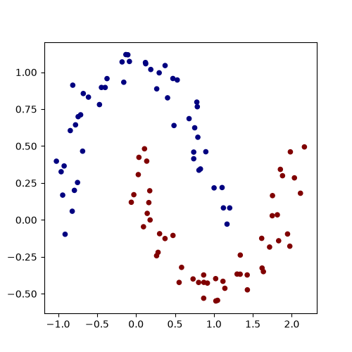
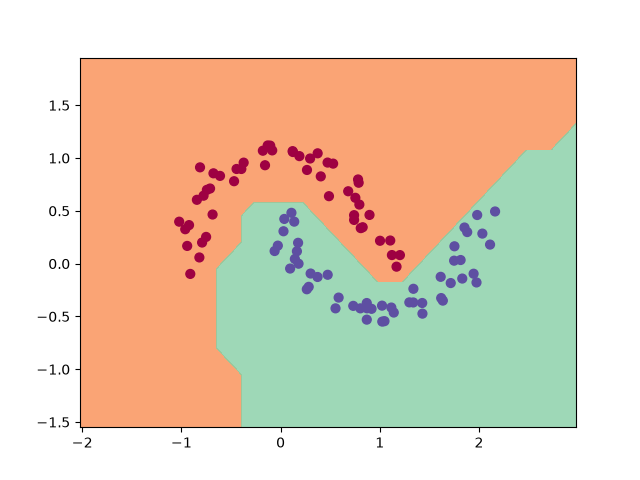

# Micrograd — Backpropagation and Digit Classification

## Overview

This project is a personal learning exercise based on [micrograd](https://github.com/karpathy/micrograd), created by [Andrej Karpathy](https://github.com/karpathy).

The objective is to understand the fundamentals of automatic differentiation and backpropagation by studying and experimenting with a minimal neural network engine implemented in Python.

Building on this educational approach, I extended my experiments to train a multilayer perceptron (MLP) for handwritten digit classification using the `scikit-learn` digits dataset.

This repository is intended as a learning project to explore the mechanisms behind neural networks, rather than as a new deep learning framework.

## Learning Objectives

- Understand computational graphs and automatic differentiation.
- Explore gradient propagation through elementary mathematical operations.
- Study loss functions, including softmax and cross-entropy.
- Train an MLP for handwritten digit classification.
- Investigate numerical stability and the limitations of scalar-based automatic differentiation compared with tensor-based frameworks such as PyTorch.

## Acknowledgements and References

This project is inspired by and builds upon Andrej Karpathy's educational implementation of micrograd.

- **Original repository:** [karpathy/micrograd](https://github.com/karpathy/micrograd)
- **Video tutorial:** [The spelled-out intro to neural networks and backpropagation: building micrograd](https://www.youtube.com/watch?v=VMj-3S1tku0&list=PLAqhIrjkxbuWI23v9cThsA9GvCAUhRvKZ)

The video provides a step-by-step explanation of the underlying concepts and the implementation of the original engine.


## SVM Results

### Data


### Decision Boundary



## Installation

### 1. Clone the repository

```bash
git clone https://github.com/rasoul24/micrograd-learning-project.git
```

Replace the repository URL and directory name above if this project is hosted in a different repository.

### 2. Create a virtual environment

```bash
python -m venv .venv
```

Activate it on **Windows (Git Bash)**:

```bash
source .venv/Scripts/activate
```

On Linux:

```bash
source .venv/bin/activate
```

### 3. Install dependencies

```bash
python -m pip install --upgrade pip
python -m pip install -r requirements.txt
```

## Usage

### Support Vector Machine demonstration

Run:

```bash
python SVM_demo.py
```

This script explores Support Vector Machine training and evaluation, following the concepts presented in Karpathy's video tutorial.

### Handwritten digit classification

Run:

```bash
python Cross_entropy_demo.py
```

This script contains my own implementation of a handwritten digit classifier using the `scikit-learn` digits dataset and a multilayer perceptron.

The implementation is experimental and primarily intended for educational purposes. Since the engine relies on scalar operations and Python-level automatic differentiation, training can be computationally expensive compared with optimized deep learning frameworks.

## Author

**Rasoul Islangueriev**

[GitHub profile](https://github.com/rasoul24)